<h1 align="center">Hi there, I'm Renzo</h1>

  
  
  

---

### About Me

I'm **Renzo Franceschini**, a software engineer from Argentina, based in **Italy**, with 10 years of backend experience. I've led backend teams and projects at **EssilorLuxottica**, **PwC** and **Forian / Helix Technologies**, usually as Tech Lead or Main Backend Engineer.

### Building Guard Core

My main focus is **[Guard Core](https://github.com/Guard-Core)**: open-source API security that runs **inside** your app instead of in front of it, so it sees what the edge can't. One detection engine, thin adapters for the framework you already run, in **Python, TypeScript, Go, Rust, PHP and the JVM**, plus a SaaS for monitoring and response at [guard-core.com](https://guard-core.com).

- [fastapi-guard](https://github.com/Guard-Core/fastapi-guard) alone gets about 62k downloads a month.
- Merged upstream in [DeepTutor](https://github.com/HKUDS/DeepTutor/pull/1980), [Xinference](https://github.com/xorbitsai/inference/pull/5664) and [Vexa](https://github.com/Vexa-ai/vexa/pull/465), and listed on [Fastify's ecosystem page](https://github.com/fastify/fastify/pull/7128).
- 6 engines, 6 telemetry agents and 23 framework adapters, one maintainer, 100% test coverage as a floor.

The full list of engines, adapters and agents lives on the [Guard-Core org](https://github.com/Guard-Core).

  
  
  
  

### The tooling behind it

Maintaining that many repos alone takes infrastructure, so I build it:

- [RoboCo](https://github.com/rennf93/roboco) - an AI agent organization: 25 agents and one human CEO running a build, review, document, merge pipeline where only the human merges to `master`.
- [Hummin](https://github.com/rennf93/hummin) - AI agent toolkit: unified LLM API, agent loop, TUI and a coding agent CLI.
- [Murmur](https://github.com/rennf93/murmur) - a local message bus for AI CLI sessions, so parallel agents can review and challenge each other's work.
- [fable-mode](https://github.com/rennf93/opus-fable-playbook) and [Agent Runway](https://github.com/rennf93/agent-runway) - Claude Code plugins for agent discipline and project-aware subagents.

  

---

## Tech Stack

<table align="center">
  <tr>
    <td align="right"><b>Languages</b></td>
    <td></td>
  </tr>
  <tr>
    <td align="right"><b>Frameworks</b></td>
    <td></td>
  </tr>
  <tr>
    <td align="right"><b>Databases</b></td>
    <td>
      
      
      
      
    </td>
  </tr>
  <tr>
    <td align="right"><b>OS</b></td>
    <td></td>
  </tr>
  <tr>
    <td align="right"><b>Cloud</b></td>
    <td></td>
  </tr>
</table>

---

<h2 align="center">Statistics</h2>

  

  
  

  
  

---

  

